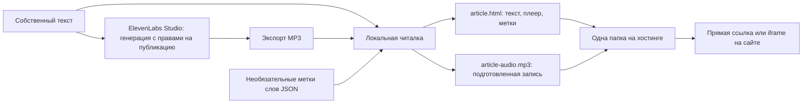

# Публикация статьи с озвучкой

В читалке `/reader/` нажмите **«Сохранить»**. В инструкции ниже есть ссылки на ElevenLabs Studio, условия использования и тарифы. Аудио из ElevenReader предназначено для личного прослушивания: запись через OBS не меняет разрешённые способы использования.

1. Создайте озвучку своего текста в Studio и экспортируйте MP3. Проверьте права на текст и голос, а также лицензию выбранного тарифа.
2. Добавьте текст и аудио в читалку. Необязательный JSON с метками слов должен соответствовать именно этому тексту и записи, включая заголовки. Без него подсветка приблизительная.
3. В окне «Сохранить материал» скачайте `article.html` и `article-audio.mp3`. Загрузите оба файла в одну папку сайта, не переименовывая. Для каждой статьи используйте отдельную папку.
4. Откройте размещённый `article.html`, проверьте звук, укажите его полный адрес в форме и скопируйте код в HTML-блок своего сайта. Хостинг должен разрешать отдачу HTML, JavaScript и аудио; некоторые конструкторы требуют отдельного статического хостинга.

Экспортированная страница работает независимо от исходной читалки: содержит текст, оглавление, метки, плеер со скоростью и переключатель автопрокрутки. Аудио хранится отдельным файлом, чтобы не создавать большую копию в Base64. Данные не отправляются автоматически; публикация происходит при загрузке файлов на ваш хостинг. Прогресс и закладки локальной читалки в публичную страницу не переносятся. API генерации и распознавание аудио не подключены.

Источники, проверенные 10 ноября 2026 года: [экспорт из ElevenReader](https://elevenlabs.io/docs/help-center/product/mobile-apps/elevenreader/can-i-download-audio-from-elevenreader), [использование озвучки ElevenReader](https://elevenlabs.io/docs/help-center/product/mobile-apps/elevenreader/can-i-use-content-generated-in-elevenreader-for-commercial-use), [Studio](https://elevenlabs.io/docs/eleven-creative/products/studio), [лицензии тарифов](https://elevenlabs.io/pricing).
