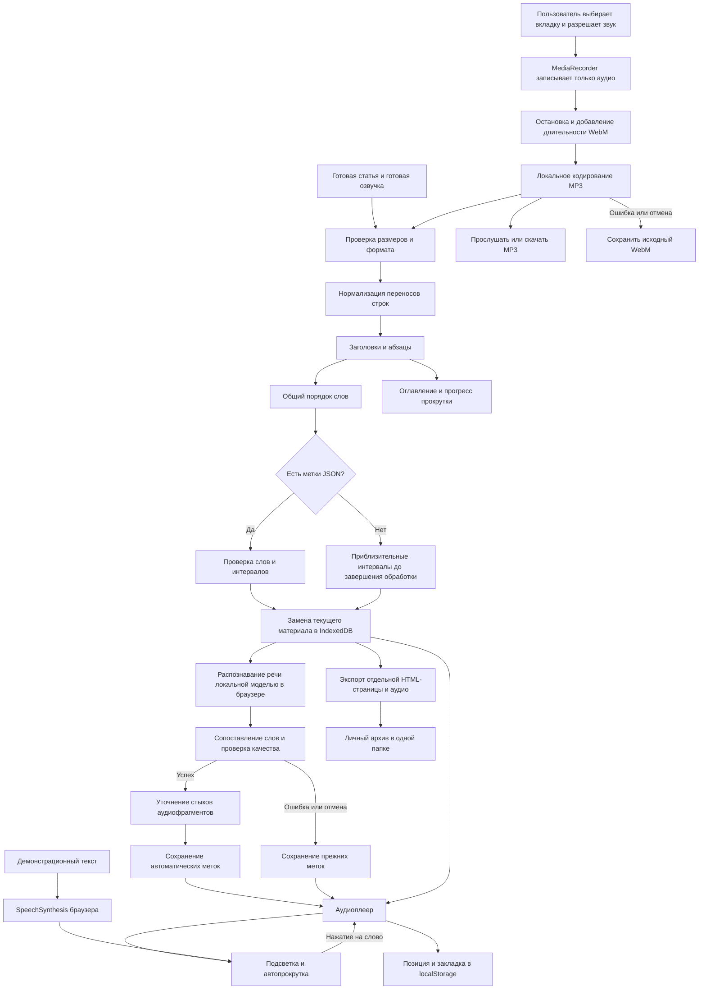

# speechread

Онлайн: [Netlify](https://speechread.netlify.app/), [Vercel](https://speechread.vercel.app/), [GitHub Pages](https://sefga.github.io/speechread/). [Настройки развёртывания](docs/deployment.md).

Локальная читалка готовой статьи с готовой озвучкой. Есть подсветка слов, перемотка нажатием на слово, оглавление, закладка и восстановление позиции.

Рабочий сценарий: **добавить текст и звук в любом порядке → создать статью → читать и слушать → скачать только MP3 или один автономный HTML со встроенным аудио**.

Генерации статей и озвучки через TTS API нет. После записи вкладки автоматически готовится MP3 без видео. Старые записи WebM/WEBA также преобразуются при скачивании. Облачного подключения к аккаунту ElevenReader и общей библиотеки сайта нет.

[Отчёт о готовности](docs/readiness.md) содержит результаты проверки и недостающие возможности.

## Запуск в Windows

Нужны Node.js 22.18+ и npm. Проверено на Node.js 22.23.2 и npm 9.8.0.

```powershell
# Выполните из корня склонированного репозитория.
Set-Location .\app
npm ci
npm run dev
```

Откройте **http://127.0.0.1:3000/**. Если сервер выбрал другой порт, используйте его адрес. Для остановки нажмите `Ctrl+C`. Аккаунт и API-ключи не нужны.

## Как пользоваться

1. Подготовьте текст статьи в UTF-8: `.txt`, `.md` или текст для вставки. PDF, DOCX, EPUB и импорт по URL не поддерживаются.
2. Подготовьте аудиозапись **этого же текста, включая заголовки**, либо используйте запись вкладки по инструкции ниже.
3. Нажмите **«Добавить материал»**. В одной форме сразу доступны выбор аудиофайла, запись вкладки, текст и название; обязательных промежуточных шагов нет.
4. Вставьте текст или перетащите TXT/Markdown в форму. Выберите либо перетащите аудио: MP3, WAV, M4A, OGG, WebM или WEBA. Текст и аудио можно перетащить одновременно, по одному файлу каждого типа. Поддержка конкретного кодека зависит от браузера.
5. Оставьте включённой **«Автоматически синхронизировать слова с записью»** и нажмите **«Создать статью»**. При наличии готового JSON раскройте **«Есть готовые метки слов?»** и выберите его вместо автоматической обработки. Для быстрого открытия можно отключить синхронизацию и запустить её позже.
6. Дождитесь сообщения о завершении синхронизации и проверьте несколько мест на слух. Первоначальная загрузка модели требует интернет и около 200 МБ; обработка длинной записи может занять значительное время.
7. Запустите воспроизведение кнопкой внизу. Нажатие на слово перемещает аудио к его метке.

Ограничения: текстовый файл до 2 000 000 байт, статья до 30 000 слов, аудио до 150 000 000 байт, JSON до 5 000 000 байт. Работа предельных размеров на слабых устройствах отдельно не проверена.

Поддерживается упрощённый Markdown: заголовки `#`–`######` и абзацы. Пустые строки разделяют абзацы. Полного форматирования Markdown, таблиц и HTML нет.

```markdown
# Введение
Текст первого раздела.

## Основная мысль
Текст следующего раздела.
```

| Действие | Управление |
| --- | --- |
| Воспроизведение / пауза | Центральная кнопка; `Пробел` вне полей и кнопок |
| Перемотка | Кнопки ±15 секунд, ползунок; стрелки `←` / `→` вне полей и кнопок |
| Переход к слову | Нажатие на слово в статье |
| Скорость | Список `0.5×`–`2×`; изменение ставит воспроизведение на паузу |
| Оглавление | Названия разделов сверху; переход отключает автопрокрутку |
| Автопрокрутка | «Следить за текстом» |
| Шрифт | «Настройки чтения» рядом с заголовком |
| Закладка | Значок в плеере; сохраняется одна позиция |
| Возврат к закладке | «Настройки чтения» → «Перейти к закладке» |
| Повторная синхронизация | «Приблизительная разметка» или «Автоматическая синхронизация» → «Синхронизировать автоматически» |
| Подключение готовых меток | Кнопка состояния разметки → «Загрузить метки JSON» |

Верхний процент показывает прокрутку текста, нижний — прослушанную часть записи.

Без загруженного аудио нижний плеер не показывается. Для демонстрации доступна отдельная кнопка **«Озвучить пример»**. После импорта кнопка **«Свернуть плеер»** убирает большую панель, сохраняя воспроизведение и компактные кнопки паузы и **«Показать плеер»**.

## Синхронизация слов

Как устроено слежение и какие есть ограничения: [синхронизация текста и аудио](docs/synchronization.md). Автоматическая синхронизация работает с импортированным аудиофайлом и записью вкладки. Ручного редактора меток пока нет.

Модель распознаёт речь локально в браузере, а приложение сопоставляет распознанные слова с текстом. Метки учитывают паузы; качество зависит от записи и распознавания, поэтому стопроцентная точность не гарантируется. Участки, которые не удалось распознать, оцениваются приблизительно. Если совпадение недостаточно, результат не применяется. До завершения, при отмене и при ошибке сохраняется прежняя разметка. Модель и её компоненты скачиваются при первом запуске и могут кешироваться браузером; аудио и текст на сервер не отправляются.

Для точной подсветки нужен массив или объект `{"words": [...]}`. Пример для текста `# Пример`, пустой строки и `Привет мир.`:

```json
[
  {"word": "Пример", "start": 0, "end": 0.7},
  {"word": "Привет", "start": 1, "end": 1.6},
  {"word": "мир.", "start": 1.6, "end": 2.1}
]
```

Время задаётся в секундах от начала записи. Нужна одна метка на каждое слово, **включая заголовки**, в том же порядке. Интервалы не должны перекрываться или выходить за длительность аудио. Читалка проверяет формат и соответствие тексту, но не проверяет саму произнесённую речь.

## Личная запись вкладки Chrome/Edge вместо OBS

1. Откройте читалку и вкладку с вашей озвучкой **в одном браузере** на этом компьютере. Поставьте озвучку на паузу в начале.
2. В читалке нажмите **«Добавить материал»**, вставьте текст и название.
3. Нажмите **«Записать звук вкладки»**. В стандартном окне Chrome/Edge выберите именно вкладку с озвучкой и включите передачу её звука. Доступ к целому экрану или окну не используется.
4. Запустите озвучку в выбранной вкладке. Запись идёт в реальном времени: паузы и ожидание также попадут в файл. Вкладку читалки держите открытой.
5. После окончания озвучки вернитесь в читалку и нажмите **«Остановить и прикрепить»**. Можно также остановить захват стандартной кнопкой браузера. Исходник сохраняется в IndexedDB, затем автоматически готовится и сохраняется MP3. Браузеру также отправляется запрос на скачивание MP3; если он его заблокировал, используйте **«Скачать запись MP3»**.
6. Прослушайте результат и нажмите **«Создать статью»**. Если закрыть форму или обновить страницу до создания статьи, при следующем открытии формы доступна кнопка **«Прикрепить последнюю запись»**. Она восстанавливает последнюю сохранённую запись, текст нужно добавить отдельно.
7. Если запись не нужна, используйте **«Отменить запись»**. Отмена удаляет текущую незавершённую запись. Уже импортированный материал не меняется.

Микрофон не запрашивается, видеодорожка не сохраняется. Захват требует HTTPS или локального адреса `localhost` / `127.0.0.1`. Поддержка передачи звука определяется браузером и выбранным источником: [Screen Capture API](https://developer.mozilla.org/en-US/docs/Web/API/MediaDevices/getDisplayMedia).

Итоговый формат — MP3, 128 кбит/с. WebM/Opus используется как промежуточный исходник. Кодек MP3 загружается при обработке, звук преобразуется на устройстве пользователя, в Worker; на сервер запись не отправляется. При ошибке или отмене подготовки MP3 исходная WebM-запись остаётся доступной для скачивания и импорта.

Метки слов из ElevenReader не переносятся. После импорта speechread может автоматически создать свои метки по распознанной речи; само преобразование в MP3 меток не создаёт. Для длинных тихих пауз доступны пропуск при прослушивании и удаление при экспорте; автоматической остановки в конце статьи нет. Записывайте длинные материалы частями: предел исходного и итогового файла — 150 МБ, сжатые файлы до завершения находятся в памяти вкладки. При достижении лимита записи сохраняется начальный фрагмент с уведомлением.

Полная запись живой вкладки ElevenReader не выполнялась при проверке. Реальная работа MediaRecorder, создание файла, длительность, перемотка и восстановление проверены на синтетическом аудиопотоке браузера. Выбор вкладки и разрешение на передачу звука выполняются пользователем.

## Скачать статью с озвучкой для личного архива

После успешного импорта нажмите **«Сохранить»** сверху или **«Скачать умную статью или аудио»** под заголовком.

1. **«Скачать умную статью»** создаёт один `article.html` с текстом, встроенным MP3, плеером и текущими метками слов. Передайте этот файл читателю: соседний аудиофайл, Next.js и локальный сервер не нужны. Откройте HTML в обычном браузере.
2. **«Скачать только аудио»** создаёт `article-audio.mp3` для обычного плеера. WebM/WEBA, WAV и другой поддерживаемый аудиофайл преобразуются автоматически; существующий MP3 копируется без повторного кодирования.
3. По желанию включите **«Удалить длинные паузы из скачиваемого файла»**. Оригинал в читалке сохраняется, а для HTML пересчитываются и метки слов. При невозможности сохранить корректные метки экспорт сообщит об ошибке: выполните синхронизацию или сохраните оригинал.
4. Для следующей статьи сохраните файл под другим именем. HTML будет примерно на треть больше встроенного MP3; подготовка длинных записей может занять время.

Это отдельная копия материала. Изменения позиции, закладки, шрифта и разметки из основной читалки в уже скачанную страницу не синхронизируются. Экспорт содержит текущие метки, включая приблизительные. Пока выполняется автоматическая синхронизация, HTML-экспорт недоступен; только аудио можно сохранить сразу.

Во время подготовки файла повторный экспорт блокируется; закрытие окна сохранения отменяет незавершённую обработку. Внутреннее имя базы `text-and-voice` сохранено для совместимости после переименования в speechread.

Для размещения на сайте достаточно загрузить HTML на хостинг. При необходимости раскройте **«Код для вставки на сайт»** в окне сохранения и укажите адрес HTML, чтобы получить iframe-код. Хостинг должен разрешать встраивание; автоматическая публикация не подключена.

## Работа с паузами

**«Пропускать паузы»** над текстом анализирует аудио и перематывает длинные тихие участки при прослушивании, не меняя файл. В автономном HTML этот переключатель доступен, если найдены паузы. Для сокращённого MP3 или HTML включите удаление пауз при экспорте.

Определяются участки тише −50 dBFS длительностью от 1,2 секунды; по краям остаётся по 0,12 секунды. Тихая речь может быть ошибочно принята за тишину, поэтому прослушайте результат. Шум и музыка могут помешать определению пауз.

## ElevenReader Ultra и публикация на своём сайте

Проверено 10 ноября 2026 года по официальной документации:

- ElevenReader не экспортирует самостоятельные аудиофайлы; офлайн-загрузка Ultra предназначена для прослушивания внутри приложения. [Экспорт](https://elevenlabs.io/docs/help-center/product/mobile-apps/elevenreader/can-i-download-audio-from-elevenreader), [возможности Ultra](https://elevenlabs.io/docs/help-center/product/mobile-apps/elevenreader/how-does-the-ultra-plan-work).
- ElevenLabs указывает, что созданная в ElevenReader озвучка предназначена для личного использования и не допускает экспорт и распространение. Запись через OBS не предоставляет дополнительных прав на публикацию. [Ограничения ElevenReader](https://elevenlabs.io/docs/help-center/product/mobile-apps/elevenreader/can-i-use-content-generated-in-elevenreader-for-commercial-use).
- ElevenReader и ElevenLabs имеют разные подписки. [Различия тарифов](https://elevenlabs.io/docs/help-center/product/mobile-apps/elevenreader/how-to-guides-for-elevenreader/how-do-elevenreader-hours-work).

Для сайта есть два официальных пути, **пока не подключённых к этому проекту**:

1. **Audio Native:** встроенный плеер ElevenLabs, который озвучивает страницу; доступен на тарифах ElevenLabs Creator и выше. В панели Audio Native выбирают голос, добавляют домен в разрешённый список и вставляют выданный HTML-код в сайт. [Инструкция Audio Native](https://elevenlabs.io/docs/eleven-creative/audio-tools/audio-native).
2. **Собственный плеер:** создать озвучку в ElevenLabs, получить аудио и метки через API, сохранить их вместе со статьёй и публиковать по постоянной ссылке. API возвращает метки символов; для этой читалки их нужно преобразовать в метки слов. [API с метками](https://elevenlabs.io/docs/api-reference/text-to-speech/convert-with-timestamps). Для публикации требуется подходящая лицензия на озвучку и выбранный голос; платные тарифы ElevenLabs описаны в [условиях использования генераций](https://elevenlabs.io/docs/overview/administration/billing).

Сама по себе загрузка материала в текущую читалку **не публикует его** для других посетителей. Экспорт HTML и аудио доступен; автоматическая загрузка на хостинг не подключена.

## Хранение и ограничения

- IndexedDB хранит **один последний материал** с аудио и отдельно **последнюю завершённую запись вкладки**. Новый успешный импорт заменяет материал, следующий захват заменяет последнюю запись; сохраняйте исходные файлы отдельно.
- Позиция аудио и одна закладка хранятся в localStorage. Шрифт, скорость, состояние автопрокрутки и положение прокрутки между открытиями не сохраняются.
- Данные привязаны к браузеру, профилю и адресу с портом. `localhost`, `127.0.0.1` и разные порты имеют разные хранилища.
- Очистка данных сайта или завершение приватного сеанса может удалить материалы. Ошибка сохранения показывается уведомлением; локальное хранилище не заменяет резервную копию.
- Код импорта не отправляет текст и аудиофайлы на сервер. SpeechSynthesis используется только для демонстрационного текста; наличие русского голоса, границ слов и работа без сети зависят от браузера и установленного голоса. MP3 при этом не создаётся.
- Для открытия страницы нужен работающий сервер или хостинг. Service Worker и гарантированный запуск без сети не реализованы.
- Читалка открывается без входа и не создаёт облачный аккаунт.

## Если что-то не работает

| Симптом | Действие |
| --- | --- |
| Импорт не завершается | Проверьте наличие текста и аудио, размеры файлов и сообщение в форме |
| Запись не открывается | Попробуйте MP3 или WAV; расширение не гарантирует поддержку кодека |
| Подсветка смещается | Проверьте соответствие текста записи, включая заголовки; повторите автоматическую синхронизацию или загрузите проверенный JSON |
| Модель не загрузилась | Проверьте интернет, свободное место и попробуйте снова в Chrome или Edge; до этого доступны прежние метки |
| JSON отклонён | Проверьте число и порядок слов, секунды, отсутствие перекрытий |
| Демонстрация молчит | Проверьте русский голос браузера или импортируйте готовую запись |
| Материал исчез | Откройте тот же профиль и адрес с тем же портом; проверьте уведомления о сохранении |
| Нужно изменить статью | Выполните новый импорт и заново выберите исходный аудиофайл |

## Проверка и сборка

```powershell
npm test
npm run typecheck
npm run build
npm audit --omit=dev
```

Статический экспорт создаётся в `out/`. Команды `npm start` нет; `next start` для статического экспорта не используется. Размещайте содержимое `out/` на статическом хостинге с поддержкой `index.html` в каталогах. HTML через `file://` не открывайте.

Если установлен Python 3, локальная проверка сборки:

```powershell
python -m http.server 3000 --bind 127.0.0.1 --directory out
```

Это сервер для локальной проверки. Канонический адрес — `/reader/`. Произвольные пути `/reader/library/...` требуют fallback на хостинге и не являются общими ссылками на материалы. Обычный файловый сервер возвращает для неизвестного пути 404.

## Поток данных


