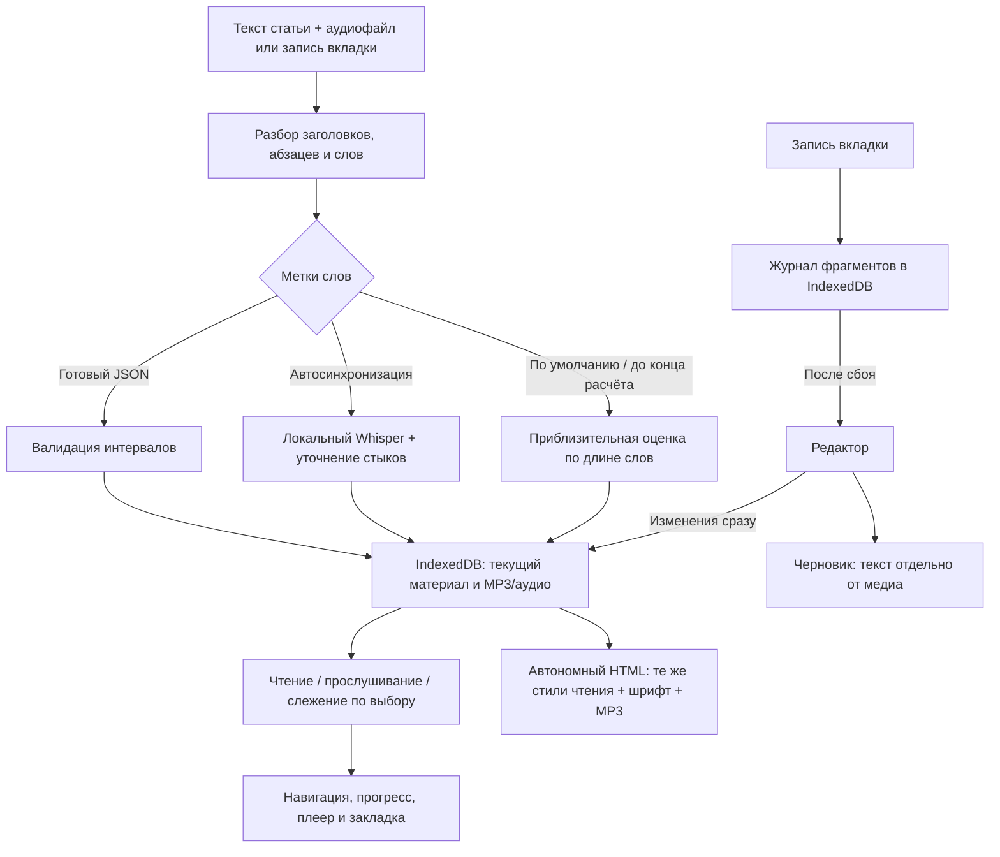

# speechread

Онлайн: [Netlify](https://speechread.netlify.app/), [Vercel](https://speechread.vercel.app/), [GitHub Pages](https://sefga.github.io/speechread/). [Настройки развёртывания](docs/deployment.md).

Локальная читалка готовой статьи с готовой озвучкой. Есть подсветка слов, перемотка нажатием на слово, оглавление, закладка и восстановление позиции.

Рабочий сценарий: **добавить текст и звук в любом порядке → выбрать способ разметки → читать и слушать → скачать только MP3 или один HTML со встроенным звуком**.

Генерации статей и озвучки через TTS API нет. После записи вкладки автоматически готовится MP3 без видео; старые записи WebM/WEBA также преобразуются при скачивании. Облачного подключения к аккаунту ElevenReader и общей библиотеки сайта нет. [Отчёт о готовности](docs/readiness.md).

## Запуск в Windows

Нужны Node.js 22.18+ и npm (проверено на Node.js 22.23.2 и npm 9.8.0).

```powershell
Set-Location .\app
npm ci
npm run dev
```

Откройте **http://127.0.0.1:3000/** (или порт, выбранный сервером). Для остановки нажмите `Ctrl+C`. Для встроенного браузерного способа аккаунт и API-ключ не нужны; облачные API подключаются отдельно по желанию.

## Как пользоваться

1. Подготовьте текст статьи в UTF-8 (`.txt`, `.md` или текст для вставки). PDF, DOCX, EPUB и импорт по URL не поддерживаются.
2. Подготовьте аудиозапись **этого же текста, включая заголовки**, либо запишите вкладку по инструкции ниже.
3. Нажмите **«Добавить материал»**. В одной форме сразу доступны текст, выбор аудиофайла и запись вкладки. TXT/Markdown и аудио можно перетащить по одному или вместе.
4. Укажите название, добавьте текст и выберите аудио (MP3, WAV, M4A, OGG, WebM или WEBA) либо запишите вкладку.
5. Нажмите **«Создать статью»**. Встроенная синхронизация по умолчанию распознаёт запись в браузере. Её можно отключить и выбрать другой способ после открытия статьи; готовый JSON также можно прикрепить при импорте.
6. Нажмите **«Синхронизация слов»** над статьёй: здесь доступны браузерный способ, OpenAI API, Gemini API, JSON и промпты для другого чата. При первом запуске встроенного способа скачивается модель (~200 МБ). Проверьте несколько мест на слух.
7. Статья открывается для чтения без большой панели аудио. Нажмите **«Слушать»** для прослушивания или **«Слушать и следить»** для подсветки и автопрокрутки. Нажатие на слово перемещает аудио к его метке.

### Изменение статьи и автоматическое сохранение

Нажмите **«Изменить статью»**. Название и текст уже открытой статьи обновляются сразу; текущее аудио остаётся прикреплённым. Изменения сохраняются автоматически, кнопку **«Готово»** можно использовать для завершения редактирования. При изменении текста прежние метки заменяются приблизительными — повторите синхронизацию после правки.

Черновик восстанавливается после закрытия формы и перезагрузки. Выделение текста за границу окна больше не закрывает редактор. Во время записи форму можно скрыть: захват продолжается, сверху появляется кнопка **«Открыть запись»**. [Как устроены сохранение и восстановление](docs/editor-recovery.md).

Ограничения: текстовый файл до 2 МБ, статья до 30 000 слов, аудио до 150 МБ, JSON до 5 МБ. Поддерживается упрощённый Markdown: заголовки `#`–`######` и абзацы, разделённые пустыми строками.

| Действие | Управление |
| --- | --- |
| Начать слушать | «Слушать»; «Слушать и следить» также включает подсветку и автопрокрутку |
| Воспроизведение / пауза | Центральная кнопка; `Пробел` вне полей и кнопок при открытом или играющем плеере |
| Перемотка | Кнопки ±15 секунд, ползунок; стрелки `←` / `→` вне полей и кнопок |
| Переход к слову | Нажатие на слово в статье |
| Скорость | Список `0.5×`–`2×`; изменение ставит воспроизведение на паузу |
| Оглавление | Названия разделов сверху; переход отключает автопрокрутку |
| Автопрокрутка | «Следить за текстом» |
| Шрифт | «Настройки чтения» рядом с заголовком |
| Закладка | Значок в плеере; сохраняется одна позиция |
| Возврат к закладке | «Настройки чтения» → «Перейти к закладке» |
| Выбор способа синхронизации | «Синхронизация слов» → встроенный способ, OpenAI или Gemini |
| Подключение готовых меток | «Синхронизация слов» → «Готовая разметка JSON» → вставить ответ или выбрать файл |
| Промпты для чата | «Синхронизация слов» → «Через чат с моделью» → скопировать инструкцию и задание |
| Сворачивание плеера | «Свернуть плеер»; звук продолжает играть, остаются компактные кнопки. После паузы они скрываются |

Верхний процент показывает прокрутку текста, нижний — прослушанную часть записи.

Без аудио нижний плеер отсутствует. Демонстрационный голос запускается отдельной кнопкой **«Озвучить пример»**.

## Синхронизация слов

**[Короткая инструкция по всем пяти способам](docs/synchronization-methods.md)** — что выбрать, как устроено браузерное распознавание, где создать ключи и как вставить JSON из чата. Подробности алгоритма: [синхронизация текста и аудио](docs/synchronization.md).

- Локальная модель Whisper распознаёт речь прямо в браузере и сопоставляет её со словами текста (включая заголовки) с уточнением границ 30-секундных фрагментов.
- До завершения обработки, а также при ошибке или отмене сохраняется прежняя разметка.
- Для ручной загрузки поддерживается JSON-массив `[{"word": "Пример", "start": 0, "end": 0.7}, ...]` или объект `{"words": [...]}` с неперекрывающимися интервалами в секундах на каждое слово статьи.

## Личная запись вкладки Chrome/Edge вместо OBS

1. Откройте читалку и вкладку с вашей озвучкой в одном браузере (Chrome или Edge). Поставьте озвучку на паузу в начале.
2. В читалке нажмите **«Добавить материал»**, вставьте текст и название.
3. Нажмите **«Записать звук вкладки»**, выберите вкладку с озвучкой и включите передачу её звука ([Screen Capture API](https://developer.mozilla.org/en-US/docs/Web/API/MediaDevices/getDisplayMedia), требуется HTTPS или `localhost` / `127.0.0.1`). Микрофон и видео не записываются.
4. Запустите озвучку в выбранной вкладке. Запись идёт в реальном времени.
5. По окончании нажмите **«Остановить и прикрепить»** и дождитесь локального кодирования в MP3 (128 кбит/с, в Web Worker). При ошибке кодирования остаётся доступен исходный WebM.
6. MP3 автоматически сохраняется в браузере, также запускается скачивание. Если браузер его заблокировал, нажмите **«Скачать запись MP3»**. **«Создать статью»** открывает запись вместе с текстом. После закрытия формы или перезагрузки можно **«Прикрепить последнюю запись»**. Незавершённый захват сохраняется фрагментами; после сбоя доступно восстановление записанной части.

Доступны пропуск длинной тишины при прослушивании и её удаление при экспорте с пересчётом меток. Автоостановки в конце статьи нет. Предел записи — 150 МБ (при достижении лимита сохраняется начальный фрагмент с уведомлением).

## Скачать статью с озвучкой для личного архива

После импорта нажмите **«Сохранить»** сверху или **«Скачать умную статью или аудио»** под заголовком:

1. **«Скачать умную статью»** — один `article.html` со встроенным MP3, шрифтом Inter, текстом и текущей разметкой. В нём доступны навигация по разделам, прогресс чтения, плеер с перемоткой и скоростью, сворачивание, слежение за текстом, настройки шрифта и закладка. Соседние файлы и сервер не нужны; файл можно передать читателю.
2. **«Скачать только аудио»** — `article-audio.mp3` для обычного плеера (не-MP3 записи конвертируются автоматически).
3. При необходимости включите удаление длинных пауз из скачиваемого файла. Оригинал не меняется, время слов для HTML пересчитывается. Проверьте результат на слух.

Для размещения на своём сайте загрузите один HTML на статический хостинг. При необходимости укажите его URL в окне сохранения, чтобы получить готовый `iframe`-код. HTML примерно на треть больше встроенного MP3. Пока идёт синхронизация, экспорт HTML недоступен; только аудио можно скачать сразу.

### Примечание об ElevenReader и публикации

- Озвучка из приложения ElevenReader предназначена для личного прослушивания и не предусматривает коммерческого распространения ([правила ElevenReader](https://elevenlabs.io/docs/help-center/product/mobile-apps/elevenreader/can-i-use-content-generated-in-elevenreader-for-commercial-use)).
- Для официальной публикации на сайте используйте [ElevenLabs Audio Native](https://elevenlabs.io/docs/eleven-creative/audio-tools/audio-native) или генерацию через [ElevenLabs API с таймкодами](https://elevenlabs.io/docs/api-reference/text-to-speech/convert-with-timestamps) на соответствующем тарифе.

## Хранение и ограничения

- Во встроенном режиме текст и аудио обрабатываются локально. OpenAI API явно отправляет аудио в OpenAI; Gemini API — аудио и текст в Google. Без выбора API и нажатия отправки облачный запрос не выполняется.
- Ключ API используется только в текущем окне и запросе: он не сохраняется в IndexedDB, localStorage или экспортируемой статье. Запросы могут быть платными.
- IndexedDB (база `text-and-voice`) хранит **один последний материал** с аудио, **черновик редактора**, **последний завершённый захват** и фрагменты незавершённой записи. Метаданные черновика дополнительно сохраняются в `localStorage`. Сохраняйте резервные копии файлов.
- Позиция аудио и одна закладка хранятся в `localStorage`. Данные привязаны к домену, порту и профилю браузера.
- Для демонстрационного текста при отсутствии аудиофайла используется `SpeechSynthesis` браузера.

## Если что-то не работает

| Симптом | Действие |
| --- | --- |
| Импорт не завершается | Проверьте наличие текста и аудио, лимиты размера и сообщение в форме |
| Запись не открывается | Попробуйте MP3 или WAV; расширение не гарантирует поддержку кодека браузером |
| Подсветка смещается | Проверьте соответствие текста записи (включая заголовки), повторите автосинхронизацию или загрузите JSON |
| Модель не загрузилась | Проверьте интернет и свободное место (~200 МБ) в Chrome/Edge; до этого действует прежняя разметка |
| JSON отклонён | Проверьте совпадение числа и порядка слов, секунды и отсутствие перекрытий |
| Материал исчез | Откройте тот же профиль браузера и тот же адрес с портом |

## Проверка и сборка

```powershell
npm test
npm run typecheck
npm run build
npm audit --omit=dev
```

Статический экспорт создаётся в `out/`. Локальная проверка статической сборки через Python 3:

```powershell
python -m http.server 3000 --bind 127.0.0.1 --directory out
```

Канонический адрес приложения — `/` (также поддерживается `/reader/`).

Общее оформление сайта и экспортируемой статьи находится в `src/lib/reader-styles.ts` (`APP_STYLES`). Обе версии используют одну строку CSS; отдельной копии стилей навигации или плеера в экспорте нет.

## Поток данных


