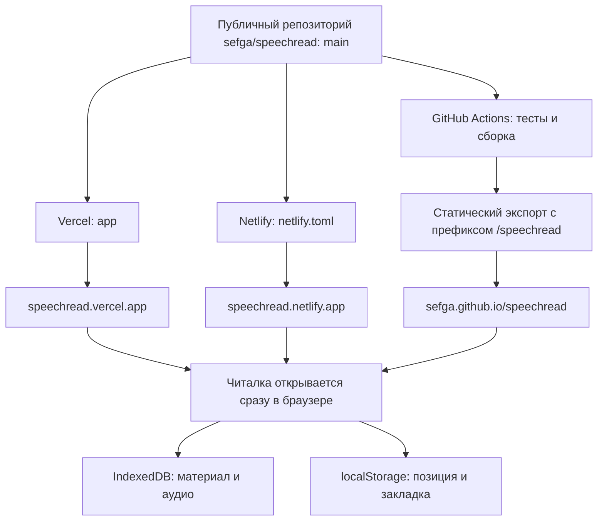

# Публикация speechread

Сайт собирается через статический экспорт Next.js. Материал и прогресс хранятся в браузере посетителя. Встроенное распознавание работает без серверной базы и ключей. По желанию посетитель может явно отправить запись в OpenAI или Gemini со своим ключом; ключ не сохраняется и не входит в сборку сайта.

| Площадка | Адрес | Настройки |
| --- | --- | --- |
| Netlify | [speechread.netlify.app](https://speechread.netlify.app/) | `netlify.toml`: база `app`, команда `npm run build`, публикация `out` |
| Vercel | [speechread.vercel.app](https://speechread.vercel.app/) | Проект `speechread`, Root Directory `app`, Next.js, ветка `main` |
| GitHub Pages | [sefga.github.io/speechread](https://sefga.github.io/speechread/) | `.github/workflows/pages.yml`, источник публикации GitHub Actions |

Изменения в `main` запускают публикацию на подключённых площадках. Workflow Pages устанавливает зависимости через `npm ci`, запускает тесты и собирает сайт. Дополнительные токены для Pages не нужны: используется встроенная авторизация GitHub Actions.

Для GitHub Pages переменная сборки `NEXT_PUBLIC_BASE_PATH` задаёт префикс `/speechread`; workflow получает его из `configure-pages`. На Vercel и Netlify переменная не задаётся. Внутренние ссылки используют `next/link`, чтобы учитывать префикс. При смене префикса сайт нужно пересобрать.

Читалка открывается сразу по основному адресу сайта, а также по пути `reader/`. Прежние адреса `reader/sign-in/` и `reader/sign-up/` тоже открывают читалку. Netlify и Vercel направляют `/reader/library/*` в читалку. На GitHub Pages произвольный путь библиотеки обрабатывается страницей 404 с сохранением HTTP-статуса 404; используйте `/speechread/` для постоянной ссылки. Эти пути не предоставляют другим посетителям доступ к вашим локальным материалам.

Хранилища трёх доменов независимы. Для переноса материала используйте исходный текст и аудиофайл либо экспорт для личного архива. Публикация приложения не загружает ваши статьи на сайт.

Справка: [статический экспорт Next.js](https://nextjs.org/docs/app/guides/static-exports), [GitHub Pages и Actions](https://docs.github.com/en/pages/getting-started-with-github-pages/using-custom-workflows-with-github-pages), [настройка сборки Netlify](https://docs.netlify.com/build/configure-builds/file-based-configuration/).
