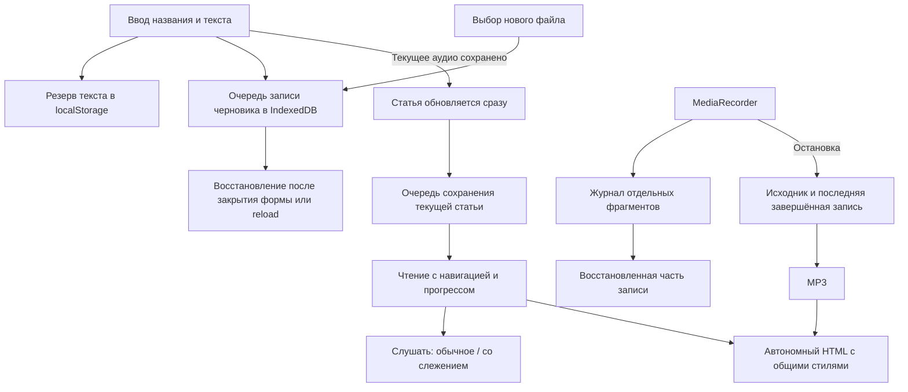

# Редактирование, сохранение и автономная статья

В открытой статье кнопка **«Изменить статью»** показывает её название, текст и уже прикреплённое аудио. Правки названия и текста применяются сразу. **«Готово»** завершает редактирование; повторно выбирать существующее аудио не требуется. После изменения текста метки становятся приблизительными: синхронизируйте запись заново, когда закончите правки.

Черновик сохраняется независимо от текущей статьи. Текст дублируется в `localStorage`, а метаданные и вложения — в IndexedDB. Вложения пишутся только при их изменении. Записи в хранилище выполняются по очереди; позднее завершение старого сохранения не должно заменять более свежие данные. Смена фокуса, скрытие страницы и закрытие редактора запускают дополнительное сохранение. Выделение текста с выходом за границу окна не закрывает форму.

Захват звука продолжается при скрытии редактора. MediaRecorder выдаёт фрагменты примерно раз в секунду; они дописываются в отдельный журнал IndexedDB. При возвращении после сбоя можно прикрепить или скачать доступную часть записи. Последняя завершённая запись хранится отдельно и не заменяется незавершённым журналом. При остановке исходник сохраняется до преобразования в MP3.

Сохранение зависит от доступности и свободного места хранилища браузера. При сбое приложение показывает предупреждение, а запись по возможности продолжается в памяти. Аварийное завершение процесса может потерять последний ещё не выданный MediaRecorder фрагмент. Перезагрузка прекращает сам захват; восстановление возвращает записанную часть. Данные разных доменов, портов и профилей браузера не объединяются.

## Чтение и прослушивание

- По умолчанию открыт текст без большой панели аудио.
- **«Слушать»** открывает плеер и запускает звук. Переключатель слежения работает независимо.
- **«Слушать и следить»** также включает подсветку слов и автопрокрутку.
- **«Свернуть плеер»** оставляет компактные кнопки и продолжает воспроизведение. После паузы остаётся кнопка **«Слушать»** над статьёй.
- Навигация по разделам закрепляется при прокрутке. Верхние процент и полоса показывают прогресс чтения; шкала в плеере — позицию аудио.

## Автономный HTML

Экспорт включает стили чтения, локальный Inter и MP3. Для чтения и прослушивания не нужны интернет, исходный сайт или соседние файлы. Доступны переходы к разделам и словам, прогресс чтения, скорость, перемотка, сворачивание плеера, слежение, размер текста и закладка. Если локальное хранилище для `file://` недоступно, читать и слушать можно, но позиция и настройки после закрытия файла могут не восстановиться.

