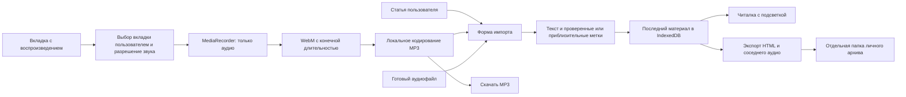

# Проверка готовности speechread

Дата: 10 ноября 2026 года. Область проверки: локальный проект в `app/`, статическая сборка и браузерные сценарии. Последнее уточнение задачи: личный архив статей и озвучки, воспроизводимой во вкладке Chrome/Edge на Windows.

**Вердикт:** основной сценарий личного архива реализован: текст → готовый аудиофайл или запись выбранной вкладки → чтение с подсветкой → сохранение HTML и аудио. Полную готовность генератора статей, TTS-сервиса или облачной библиотеки подтвердить нельзя: этих возможностей нет. Запись живого ElevenReader требует отдельной пользовательской пробы; при автоматической проверке использован синтетический звуковой поток браузера.

## Что проверено

| Проверка | Результат |
| --- | --- |
| `npm test` | 14 тестов пройдены: синхронизация, Markdown, валидация, экспорт, экранирование HTML, освобождение источника записи, реальное кодирование MP3 и отмена |
| `npm run typecheck` | Пройдено, строгая проверка TypeScript |
| `npm run build` | Пройдено; статические страницы созданы в `out/` |
| `npm run dev -- --port 3006` | Сервер запустился, `/reader/` вернул HTTP 200 |
| `npm audit --omit=dev` | Известных уязвимостей рабочих зависимостей не обнаружено на дату проверки; это не полный аудит безопасности |
| Импорт WAV и точного JSON | Пройдено; проверены подсветка и переход по слову |
| Управление аудио | Проверены воспроизведение, пауза, скорость 1.5×, закладка и восстановление после обновления |
| Запись MediaRecorder | Реальный WebM/Opus создан из синтетического аудиопотока браузера |
| Длительность WebM | Конечная, определяется браузером; файл успешно импортирован и восстановлен после обновления |
| Автоматический MP3 после записи | Проверено на синтетическом звуковом потоке; в форме появился настоящий MP3 с конечной длительностью |
| MP3 из файла пользователя | WebM/Opus 31.462699 с преобразован через интерфейс в MP3 31.464979 с; FFprobe подтвердил MP3 48 кГц, а FFmpeg декодировал весь файл без ошибок |
| Связь экспорта с MP3 | Скачанная HTML-страница ссылается на `article-audio.mp3`, совпадающий с именем скачанного аудиофайла |
| Отказ пользователя в доступе | Сообщение об ошибке показано; форма снова доступна |
| Источник без звуковой дорожки | Сообщение с подсказкой; все полученные дорожки освобождены |
| Отмена записи | Источник остановлен, незавершённая запись не прикреплена |
| `Escape` во время записи | Диалог остаётся открытым; доступны явные кнопки остановки и отмены |
| Мобильная ширина | На 320 и 390 px горизонтальной прокрутки нет; форма записи осмотрена на 320 px |
| Скачивание архива | HTML и WAV скачаны браузером; SHA-256 аудиофайла совпал с исходным WAV |
| Самостоятельная HTML-страница | Открыта через `file://` с соседним аудиофайлом; переход к слову перемотал аудио на 3 секунды |
| Ошибка восстановления | Повреждённые метки в тестовой IndexedDB вызвали уведомление; исходная запись и её аудио сохранились, демонстрация их не перезаписала |

Среда: Windows, Node.js 22.23.2, npm 9.8.0, Next.js 16.4.6, React 19.3.1, TypeScript 5.9.3. Браузерная проверка выполнена в управляемом Chromium; отдельный полный прогон в пользовательских Chrome и Edge не проводился.

Проверка скачивания выявила ограничение Windows-пути в команде скачивания инструмента автоматизации. После настройки браузерного скачивания файлы получены обычными нажатиями на кнопки приложения. Это ограничение инструмента проверки не требует изменений пользовательского приложения.

## Изменения в ходе проверки

| До | После |
| --- | --- |
| В форме был только выбор аудиофайла | Добавлена запись выбранной вкладки, прослушивание результата, скачивание WebM и прикрепление к статье |
| Запись могла бы содержать видео | В MediaRecorder передаются только звуковые дорожки; микрофон не запрашивается |
| WebM из MediaRecorder не содержал конечной длительности | Добавляется длительность через `@fix-webm-duration/fix`; доступен повторный импорт и поиск позиции |
| Длинная запись могла превысить предел импорта | При достижении лимита сохраняется начальный фрагмент с уведомлением; исходные данные находятся в памяти до завершения |
| Закрытие native dialog через `Escape` обходило запрет закрытия | Закрытие заблокировано во время записи и импорта; явная отмена освобождает источник |
| Не было понятного личного сценария сохранения | Окно сохранения описывает архив из `article.html` и соседнего аудио; существующий экспорт HTML проверен в браузере |
| Заголовок Markdown захватывал следующий абзац без пустой строки | Заголовки и абзацы разделяются корректно, включая CRLF; добавлены регрессионные тесты |
| Некорректная длительность могла пройти валидацию меток | NaN, Infinity, нулевая и отрицательная длительность отклоняются |
| Ошибка чтения сохранённого материала могла привести к его перезаписи демонстрацией | Автосохранение включается после успешного восстановления или явного импорта |
| Недоступный localStorage прерывал восстановление аудио из IndexedDB | Восстановление аудио продолжается; проблема позиции и закладки сообщается отдельно |
| WebM/WEBA был неудобен для обычных плееров | Записи автоматически готовятся в MP3; старые файлы преобразуются при скачивании, исходник доступен при ошибке |
| Название было «Текст и голос» | speechread в интерфейсе, заголовке вкладки, HTML-экспорте и документации; старое имя базы сохранено для доступа к данным |
| На стартовой странице предлагался неподключённый вход | Читалка открывается сразу, без страницы входа и создания аккаунта |
| Не было команды разработки и отдельной проверки типов | Добавлены `npm run dev`, `npm run typecheck` и инструкция |

## Что осталось за пределами готовой версии

- Генерация статей, подключение LLM и генерация озвучки через TTS API.
- Официальный импорт из аккаунта ElevenReader или скачивание его внутренних файлов. Запись вкладки — пользовательский захват воспроизведения, а не интеграция с аккаунтом.
- Автоматические точные метки слов. Захват вкладки их не получает; без отдельного JSON подсветка приблизительная.
- Автообрезка тишины, определение конца речи и остановка в конце статьи. Пользователь запускает и останавливает запись самостоятельно.
- Пакетная обработка нескольких файлов, автообрезка тишины и экспорт других выбранных пользователем кодеков. Подготовка MP3 уже реализована.
- Библиотека нескольких материалов в IndexedDB. Текущая читалка хранит последний материал; отдельные скачанные папки служат личным архивом.
- Облачная авторизация, общие постоянные ссылки, автоматическая публикация и серверное резервное копирование. Supabase не подключён; проверка RLS к текущему коду неприменима. При добавлении Supabase Auth и RLS потребуют отдельной проверки.
- Гарантированный офлайн-запуск основной Next.js-читалки: Service Worker отсутствует. Отдельная экспортированная HTML-страница работает с локальным аудиофайлом.

## Практические пределы проверки

Не проверены живая вкладка ElevenReader, мобильные браузеры, Safari/Firefox, предельные файлы 150 МБ / 30 000 слов, многочасовая запись, исчерпание диска и работа на Orange Pi. Исходники устройств, камера и SQLite в этом проекте отсутствуют.

Текущий механизм держит запись в памяти вкладки. Для длинных материалов записывайте отдельные части и сохраняйте результат перед закрытием страницы. Очистка данных браузера удаляет текущий материал; скачанный архив от этого не зависит.

Для публикации на хостинге отдельно проверьте доступ к файлам, возможность iframe и HTTP Range для аудио. На простом HTTP-сервере без Range перемотка удалённой записи может быть недоступна; локальный HTML с аудио проверен успешно.

Проценты прежней проверки визуального сходства не подтверждают наличие генерации, экспорта ElevenReader или облачного хранения.

## Материалы проверки

Локальные снимки и тестовые файлы находились в `app/output/playwright/`; результаты браузерных проверок перечислены выше. Папка временных файлов не включается в репозиторий. [Инструкция по использованию](../README.md).

## Архитектура личного архива

