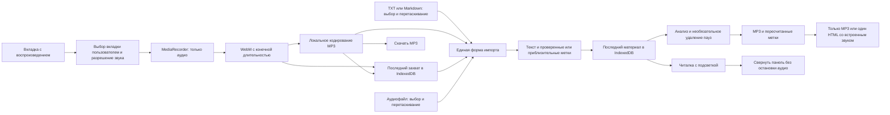

# Проверка готовности speechread

Дата: 10 ноября 2026 года. Область проверки: локальный проект в `app/`, статическая сборка и браузерные сценарии. Последнее уточнение задачи: личный архив статей и озвучки, воспроизводимой во вкладке Chrome/Edge на Windows.

**Вердикт:** основной сценарий личного архива реализован: единая форма текста и аудио → чтение с подсветкой → только MP3 или один автономный HTML со встроенным аудио. Доступны перетаскивание TXT/Markdown и аудио, сохранение последнего захвата, сворачивание плеера и два режима работы с паузами. Генератор статей, TTS-сервис и облачная библиотека не подключены. Запись живого ElevenReader требует отдельной пользовательской пробы; при автоматической проверке использован синтетический звуковой поток браузера.

## Что проверено

| Проверка | Результат |
| --- | --- |
| `npm test` | 72 теста пройдено: прежние сценарии, промпты и JSON, OpenAI/Gemini payload и ответы, ограничения, отмена и безопасные ошибки |
| `npm run typecheck` | Пройдено, строгая проверка TypeScript |
| `npm run build` | Пройдено; статические страницы созданы в `out/` |
| `npm run dev -- --port 3011` | Сервер запустился; полный путь проверен на `/reader/` |
| `npm audit --omit=dev` | Известных уязвимостей рабочих зависимостей не обнаружено на дату проверки; это не полный аудит безопасности |
| Импорт WAV и точного JSON | Пройдено; проверены подсветка и переход по слову |
| Автоматическая синхронизация | В Chromium распознаны 15 из 15 слов русской тестовой записи с тишиной; на записи 43 с совпали 45 из 45 слов. Уточнение стыка изменило начало слова с 30,70 до 30,10 с, ожидаемое по повторению — около 30,09 с. Проверены отмена, сохранение, экспорт и отказ при несовпадении текста |
| Управление аудио | Проверены воспроизведение, пауза, восстановление и сворачивание без остановки. Без аудио плеер отсутствует. Скорость 1.5× и закладка проверены ранее |
| Запись MediaRecorder | Реальный WebM/Opus создан из синтетического аудиопотока браузера |
| Длительность WebM | Конечная, определяется браузером; файл успешно импортирован и восстановлен после обновления |
| Автоматический MP3 после записи | Реальный MediaRecorder на синтетическом потоке: MP3 автоматически скачан, сохранён в IndexedDB и восстановлен после перезагрузки |
| MP3 из файла пользователя | WebM/Opus 31.462699 с преобразован через интерфейс в MP3 31.464979 с; FFprobe подтвердил MP3 48 кГц, а FFmpeg декодировал весь файл без ошибок |
| Связь экспорта с MP3 | Скачанная HTML-страница содержит MP3 в data URL и не требует соседних файлов |
| Отказ пользователя в доступе | Сообщение об ошибке показано; форма снова доступна |
| Источник без звуковой дорожки | Сообщение с подсказкой; все полученные дорожки освобождены |
| Отмена записи | Источник остановлен, незавершённая запись не прикреплена |
| `Escape` во время записи | Диалог остаётся открытым; доступны явные кнопки остановки и отмены |
| Выбор и перетаскивание | Открывается выбор аудио; отмена сохраняет прикреплённый файл. Пройдено перетаскивание MD отдельно и пары MD/WAV вместе |
| Асинхронный импорт | При задержке чтения Markdown новая аудиозапись сохраняет приоритет; ручной ввод отменяет применение устаревшего текста, создание статьи ждёт окончания чтения |
| Способы синхронизации | В UI доступны 5 способов, объяснение браузерного режима, копирование двух промптов и вставка JSON; интерфейс проверен на 4 ширинах |
| OpenAI и Gemini | Запросы и ответы проверены через mock без оплаты: метки применяются после проверки, HTTP 401 сохраняет прежние; ключ не сохраняется и не выводится в ошибке. Реальные платные запросы не выполнялись |
| Мобильная ширина | На 320, 390, 768 и 1440 px нет горизонтальной прокрутки страницы и формы |
| Паузы | Пропуск при воспроизведении, включая отключённый RAF, сокращение MP3 и HTML проверены на шестисекундной записи с длинной тишиной; метки пересчитаны |
| Скачивание архива | MP3 и один автономный HTML скачаны через интерфейс; отдельно проверены сокращённые версии |
| Самостоятельная HTML-страница | Открыта через `file://` без соседнего аудио; работают воспроизведение и переход к слову, HTTP-запросов нет |
| Ошибка восстановления | Повреждённые метки в тестовой IndexedDB вызвали уведомление; исходная запись и её аудио сохранились, демонстрация их не перезаписала |

Среда: Windows, Node.js 22.23.2, npm 9.8.0, Next.js 16.4.6, React 19.3.1, TypeScript 5.9.3. Последний полный браузерный прогон выполнен Playwright в Edge без окна с чистым контекстом; также использован управляемый Chromium. Пользовательский профиль и живая вкладка ElevenReader не проверялись.

Проверка скачивания выявила ограничение Windows-пути в команде скачивания инструмента автоматизации. После настройки браузерного скачивания файлы получены обычными нажатиями на кнопки приложения. Это ограничение инструмента проверки не требует изменений пользовательского приложения.

## Изменения в ходе проверки

| До | После |
| --- | --- |
| В форме был только выбор аудиофайла | Добавлена запись выбранной вкладки, прослушивание результата, скачивание WebM и прикрепление к статье |
| Запись могла бы содержать видео | В MediaRecorder передаются только звуковые дорожки; микрофон не запрашивается |
| WebM из MediaRecorder не содержал конечной длительности | Добавляется длительность через `@fix-webm-duration/fix`; доступен повторный импорт и поиск позиции |
| Длинная запись могла превысить предел импорта | При достижении лимита сохраняется начальный фрагмент с уведомлением; исходные данные находятся в памяти до завершения |
| Закрытие native dialog через `Escape` обходило запрет закрытия | Закрытие заблокировано во время записи и импорта; явная отмена освобождает источник |
| Не было понятного личного сценария сохранения | Окно сохранения описывает архив из `article.html` и соседнего аудио; существующий экспорт HTML проверен в браузере |
| Заголовок Markdown захватывал следующий абзац без пустой строки | Заголовки и абзацы разделяются корректно, включая CRLF; добавлены регрессионные тесты |
| Некорректная длительность могла пройти валидацию меток | NaN, Infinity, нулевая и отрицательная длительность отклоняются |
| Ошибка чтения сохранённого материала могла привести к его перезаписи демонстрацией | Автосохранение включается после успешного восстановления или явного импорта |
| Недоступный localStorage прерывал восстановление аудио из IndexedDB | Восстановление аудио продолжается; проблема позиции и закладки сообщается отдельно |
| WebM/WEBA был неудобен для обычных плееров | Записи автоматически готовятся в MP3; старые файлы преобразуются при скачивании, исходник доступен при ошибке |
| Название было «Текст и голос» | speechread в интерфейсе, заголовке вкладки, HTML-экспорте и документации; старое имя базы сохранено для доступа к данным |
| На стартовой странице предлагался неподключённый вход | Читалка открывается сразу, без страницы входа и создания аккаунта |
| Не было команды разработки и отдельной проверки типов | Добавлены `npm run dev`, `npm run typecheck` и инструкция |

## Что осталось за пределами готовой версии

- Генерация статей, подключение LLM и генерация озвучки через TTS API.
- Официальный импорт из аккаунта ElevenReader или скачивание его внутренних файлов. Запись вкладки — пользовательский захват воспроизведения, а не интеграция с аккаунтом.
- Безошибочные метки для любой записи. Захват вкладки не получает метки исходного сервиса; автоматическое распознавание создаёт собственные метки, точность зависит от качества речи и совпадения текста.
- Определение конца речи и остановка в конце статьи. Пользователь запускает и останавливает запись самостоятельно.
- Пакетная обработка нескольких статей и экспорт других выбранных пользователем кодеков. Подготовка MP3 и удаление длинных тихих пауз уже реализованы.
- Библиотека нескольких материалов в IndexedDB. Сохраняются последний материал и отдельно последний захват вкладки; автономные HTML служат личным архивом.
- Облачная авторизация, общие постоянные ссылки, автоматическая публикация и серверное резервное копирование. Supabase не подключён; проверка RLS к текущему коду неприменима. При добавлении Supabase Auth и RLS потребуют отдельной проверки.
- Гарантированный офлайн-запуск основной Next.js-читалки: Service Worker отсутствует. Отдельная экспортированная HTML-страница содержит аудио и работает самостоятельно.

## Практические пределы проверки

Не проверены живая вкладка ElevenReader, мобильные браузеры, Safari/Firefox, предельные файлы 150 МБ / 30 000 слов, многочасовая запись, исчерпание диска и работа на Orange Pi. Исходники устройств, камера и SQLite в этом проекте отсутствуют.

Текущий механизм держит запись в памяти вкладки. Для длинных материалов записывайте отдельные части и сохраняйте результат перед закрытием страницы. Очистка данных браузера удаляет текущий материал; скачанный архив от этого не зависит.

Для публикации на хостинге достаточно одного HTML; отдельно проверьте доступ к файлу и разрешение iframe. Встроенное аудио не требует отдельного HTTP Range-ресурса. Материалы не загружаются на хостинг автоматически.

Проценты прежней проверки визуального сходства не подтверждают наличие генерации, экспорта ElevenReader или облачного хранения.

## Материалы проверки

Локальные снимки и тестовые файлы находились в `app/output/playwright/`; результаты браузерных проверок перечислены выше. Папка временных файлов не включается в репозиторий. [Инструкция по использованию](../README.md).

## Архитектура личного архива

