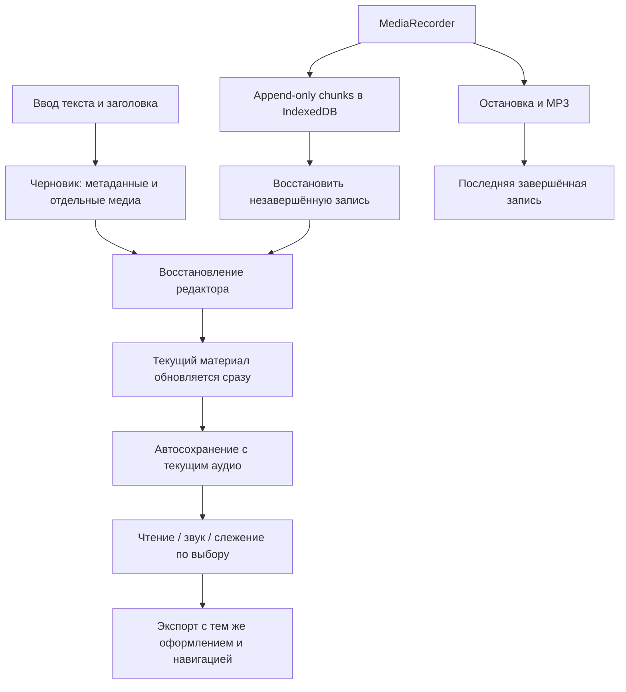

# Устойчивое редактирование и восстановление захвата

В подключённой вкладке воспроизведены потеря черновика при закрытии и самозакрытие формы при выделении заголовка с выходом за границу диалога. Пользователь уточнил, что использует Яндекс Браузер. Ввод символов сам по себе закрытия не вызвал. Сохранённая статья и аудио пользователя не заменялись. Подключение отладчика затем прервалось; проверка исправленного интерфейса в Яндекс Браузере пока не завершена.

Выбранные изменения:

- [x] Исключить закрытие редактора через backdrop и сохранять его компонент при скрытии, чтобы не останавливать запись.
- [x] Сохранять текст и название черновика независимо от текущего материала; восстанавливать после закрытия, смены фокуса и reload.
- [x] При редактировании использовать уже прикреплённое аудио; менять название и текст статьи сразу.
- [x] Писать chunks MediaRecorder в IndexedDB без переписывания растущего Blob; восстанавливать незавершённый захват.
- [x] Открывать статью в режиме чтения; включать звук и слежение отдельно, сворачивать плеер без остановки.
- [x] Перенести в автономный HTML оформление навигации, прогресс, шрифт и управление чтением и плеером.
- [x] Модульные тесты: 110/110; проверка типов и статическая сборка прошли.
- [ ] Опубликовать исправление на Vercel, Netlify и GitHub Pages.
- [ ] Проверить исправленный интерфейс в Яндекс Браузере после восстановления подключения отладчика.

Ограничения: аварийное завершение может потерять ещё не выданный MediaRecorder chunk. Старый материал и последняя завершённая запись не заменяются пустыми/неполными данными. Версия IndexedDB остаётся 1 ради совместимости уже открытых вкладок. Промежуточные данные пишутся отдельно от current и last-capture.

