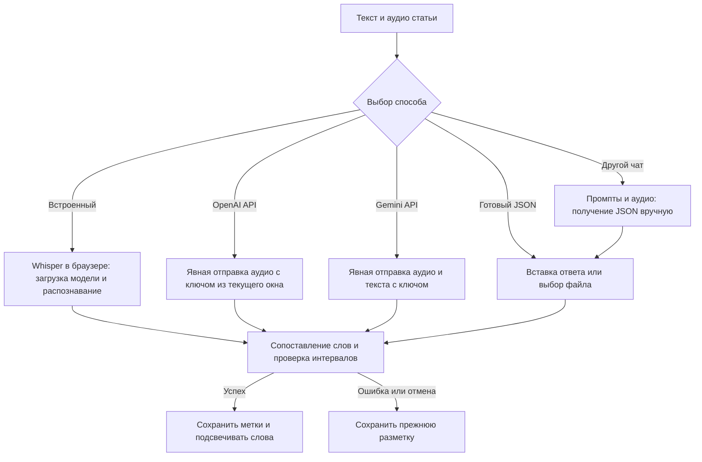

# Как выбрать способ разметки

1. Добавьте статью и аудио этого же текста, включая озвученные заголовки.
2. Над статьёй нажмите **«Синхронизация слов»**.
3. Выберите способ ниже. После обработки проверьте начало, середину, паузы и конец записи на слух.

| Способ | Что нужно | Где обрабатывается запись | Когда выбирать |
| --- | --- | --- | --- |
| Встроенный браузерный | Без ключа; интернет для первой загрузки модели | На вашем устройстве | Основной вариант без отправки аудио в облако |
| OpenAI API | Собственный API-ключ; файл до 25 МБ | OpenAI | Нужны словные метки от сервиса распознавания |
| Gemini API | Собственный API-ключ; файл до 12 МБ | Google | Нужна мультимодальная оценка времени слов; результат особенно важно проверить |
| Готовый JSON | Ответ с метками или файл JSON | Проверяется в браузере | Уже есть разметка от другого инструмента |
| Через чат с моделью | Модель с доступом к аудио, системный промпт и задание | В выбранном вами чате | Хотите получить JSON отдельно и вставить его вручную |

## Встроенный способ: что происходит

Это **распознавание аудио**, а не озвучивание текста голосом браузера.

1. При первом запуске браузер скачивает Whisper base и компоненты модели — примерно 200 МБ. Нужны интернет и свободное место.
2. Модель распознаёт речь в вашей вкладке. Аудио и текст не отправляются в облачный сервис распознавания.
3. Читалка сопоставляет распознанные слова со словами статьи, определяет их время и проверяет соответствие.
4. При воспроизведении время аудио сравнивается с метками: нужное слово подсвечивается, при необходимости текст прокручивается.

Модель может кешироваться браузером. Кеш не гарантирован: после очистки данных или удаления браузером компоненты придётся загрузить снова. Длинная запись требует времени и нагружает процессор и память. Не закрывайте вкладку до окончания обработки. При отмене, ошибке или плохом совпадении текста сохраняются прежние метки.

Кнопка **«Озвучить пример»** — отдельная демонстрация через SpeechSynthesis. Она не распознаёт ваш файл, не скачивает Whisper и не создаёт MP3.

## OpenAI API

1. Создайте ключ в [панели OpenAI](https://platform.openai.com/api-keys), проверьте доступ к API и баланс.
2. В разделе синхронизации выберите **OpenAI API** и вставьте ключ.
3. Нажмите **«Отправить аудио в OpenAI и создать метки»**. Запись отправится непосредственно в OpenAI; локальную модель скачивать не нужно.

Используется `whisper-1` с `verbose_json` и `timestamp_granularities[]=word`. Ключ идёт в заголовке авторизации, не сохраняется в IndexedDB, localStorage, экспортируемой статье или репозитории. Запрос может быть платным. Для файла больше 25 МБ используйте встроенный способ или подготовьте отдельные фрагменты с соответствующим текстом.

На 10 ноября 2026 года только `whisper-1` поддерживает используемые словные временные метки; OpenAI объявил отключение этой модели **26 февраля 2027 года**. Обычная текстовая транскрипция без времени слов не подменяет синхронизацию. [Официальная документация OpenAI](https://developers.openai.com/api/docs/guides/speech-to-text).

## Gemini API

1. Создайте ключ в [Google AI Studio](https://aistudio.google.com/apikey) и проверьте доступ к выбранной модели и квоту.
2. Выберите **Gemini API**, вставьте ключ и при необходимости измените имя доступной вам модели.
3. Отправьте запись. В Google уйдут аудио и задание со словами статьи. После ответа читалка проверит JSON, количество и порядок слов, длительность и отсутствие перекрытий.

Используется Interactions API с `store:false`, встроенным аудио и JSON Schema. Лимит приложения — 12 МБ аудио и 20 МБ всего запроса вместе с текстом и base64. Ключ используется только в заголовке запроса и не сохраняется. Запрос может быть платным.

Границы слов оценивает мультимодальная модель. Правильный JSON не доказывает точность времени: все метки Gemini считаются оценочными. При ошибке или неполном ответе прежняя разметка сохраняется. [Аудио в Gemini](https://ai.google.dev/gemini-api/docs/audio?hl=en), [Interactions API](https://ai.google.dev/api/interactions-api?hl=en).

## Промпты для другого чата и вставка JSON

1. Выберите **«Через чат с моделью»**. Приложите к выбранному чату ту же аудиозапись. Убедитесь, что модель действительно умеет анализировать аудио.
2. Скопируйте **системный промпт** и **задание со статьёй** из читалки. Если поля системной инструкции нет, отправьте оба текста одним сообщением.
3. Задание уже содержит длительность и точный список слов, включая заголовки. Просите время по аудио, а не равномерное распределение по тексту.
4. Скопируйте полный JSON-ответ в поле **«JSON с метками»** и нажмите **«Проверить и применить JSON»**. Можно вставить массив, объект с `words` или целый блок кода JSON из чата. Альтернатива — выбрать файл JSON до 5 МБ.
5. Исправьте ошибки, если валидатор их обнаружил, затем проверьте время слов на слух. При отклонении ответа текущий материал не меняется.

Для текста `Привет мир.` пример формата:

```json
{"words":[{"word":"Привет","start":0.2,"end":0.6},{"word":"мир.","start":0.7,"end":1.2}]}
```

Это только пример структуры. Для вашей записи нужны реальные секунды и все её слова. Текстовый промпт без доступа модели к аудио не позволяет определить достоверное время речи.


