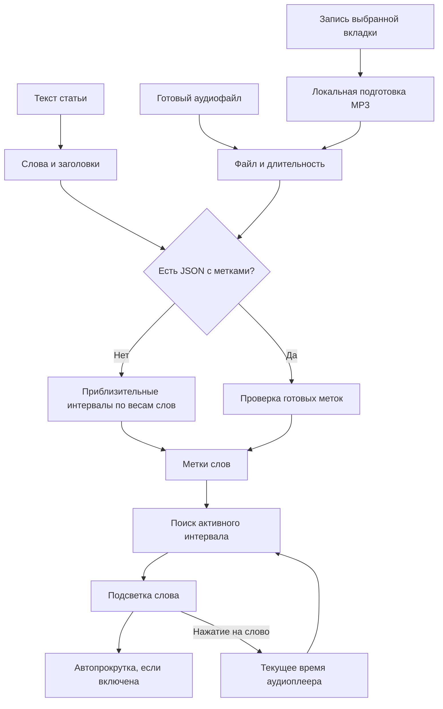

# Синхронизация в SmartReader

На 10 ноября 2026 года читалка поддерживает приблизительную разметку и загрузку готовых меток слов. **Ручной подгонки и анализа речи в приложении пока нет.** Загруженный аудиофайл и звук, записанный из вкладки, проходят одинаковую синхронизацию.

## Что работает сейчас

| Источник | Как определяется активное слово | Точность |
| --- | --- | --- |
| Готовый аудиофайл без JSON | Вся длительность распределяется по длине слов и пунктуации | Приблизительная; звук не анализируется |
| Запись вкладки без JSON | После остановки WebM преобразуется в MP3; применяется тот же расчёт | Приблизительная; метки из исходного сервиса не переносятся |
| Аудио и JSON с метками | Текущее время аудио сравнивается с `start` / `end` каждого слова | Зависит от качества загруженных меток |
| Встроенная демонстрация SpeechSynthesis | События границ речи браузера соотносятся с позицией в тексте | Зависит от браузера и установленного голоса |

Текст делится на слова, заголовки включаются в общий порядок. При приблизительной разметке вес слова — число букв и цифр, минимум 2; добавляется вес 4 после точки, вопросительного или восклицательного знака и 2 после запятой, точки с запятой или двоеточия. Доля веса определяет долю общей длительности. Это оценка темпа, а не распознавание произнесённых слов.

Пример: если запись длится 10 минут, а первое предложение получило 1% общего веса, приложение отведёт ему примерно 6 секунд. Реальная дикторская пауза при этом неизвестна. Тишина перед началом речи также включается в общую длительность и смещает подсветку.

Для воспроизводимого файла источник времени — `HTMLAudioElement.currentTime`. На событии `timeupdate` читалка двоичным поиском находит интервал текущего слова и подсвечивает его. Во время паузы между точными метками активное слово отсутствует. Нажатие на слово устанавливает `currentTime` в его `start`.

Переключатель **«Следить за текстом» управляет только автопрокруткой** к активному слову. Он не улучшает разметку. Скорость `0.5×`–`2×` меняет воспроизведение; интервалы остаются в секундах самой записи, поэтому при корректных метках синхронизация сохраняется.

В записанном WebM добавляется длительность, необходимая для перемотки. Эта операция не распознаёт речь, не вырезает тишину и не создаёт метки слов. Записанные ожидание, паузы и ускоренное воспроизведение остаются частью файла.

Затем запись преобразуется в обычный MP3 для совместимости с плеерами. Это смена контейнера и кодека, а не улучшение синхронизации. При экспорте существующие метки включаются в HTML и относятся к той же записи. На проверочном файле пользователя длительность исходника составляла 31.462699 с, MP3 из браузера — 31.464979 с; наличие больших расхождений на длинных материалах отдельно не проверялось.

## Как подключить готовые метки

В читалке нажмите **«Приблизительная разметка»** или **«Точные метки»**, затем **«Загрузить метки JSON»**. Их можно выбрать и при первом импорте материала.

```json
[
  {"word": "Привет", "start": 2.5, "end": 2.9},
  {"word": "мир.", "start": 3.0, "end": 3.6}
]
```

Для этого примера текст должен состоять из двух слов `Привет мир.`. Время — секунды от начала конкретного аудиофайла. Нужна одна метка для каждого слова, включая озвученные заголовки. Количество и порядок слов проверяются; интервалы должны быть конечными, положительной длины и без перекрытий. Сам звук на соответствие словам не проверяется.

После применения метки сохраняются вместе с материалом и входят в экспортируемую HTML-страницу. Замена исходной записи, её обрезка или изменение текста могут потребовать новых меток.

## Какие режимы подгонки можно добавить

Это варианты развития, **не реализованные функции интерфейса**:

| Механизм | Что исправляет | Ограничение |
| --- | --- | --- |
| Сдвиг начала речи, например +2.5 секунды | Постоянную задержку или тишину в начале | Не исправляет разные паузы внутри статьи |
| Две опорные точки: начало и конец речи | Общий сдвиг и равномерную разницу темпа | Не учитывает локальные изменения скорости |
| Опорные точки по абзацам | Пользователь отмечает время начала нескольких абзацев; промежутки рассчитываются отдельно | Нужна ручная работа, интервалы слов остаются оценочными |
| Forced alignment: готовый текст + запись | Модель сопоставляет речь с уже известным текстом и выдаёт время слов | Требуются вычисления; качество зависит от языка, записи и соответствия текста |

Для записи длинной статьи с естественными паузами предпочтительно **forced alignment**, а ручные опорные точки полезны для исправления отдельных мест. Это инженерная рекомендация: одинаковый сдвиг не может исправить переменные задержки.

Один из облачных вариантов — [ElevenLabs Forced Alignment](https://elevenlabs.io/docs/overview/capabilities/forced-alignment): сервис принимает запись и её текст и возвращает временные метки, включая слова; русский указан среди поддерживаемых языков. Это отдельная интеграция API, сейчас не подключённая к SmartReader. Текст и запись передаются сервису. Его [ответ API](https://elevenlabs.io/docs/api-reference/forced-alignment/create/) использует поле `text` у слова, а импорт SmartReader ожидает `word`; потребуется преобразование и проверка соответствия токенов.

Локальный вариант для Windows-компьютера — [WhisperX](https://github.com/m-bain/whisperX): распознавание и отдельный этап выравнивания дают метки слов; предусмотрен запуск на CPU. Это не функция текущего статического приложения: понадобятся Python, модели и локальный обработчик. Установка и скорость на этом компьютере не проверялись. Для известной статьи исходный текст следует сохранять основным, проверяя расхождения с распознанной речью.

## Путь данных



Основная реализация: [разметка и поиск слова](../src/lib/sync.ts), [плеер и автопрокрутка](../src/components/Reader.tsx), [запись WebM](../src/lib/recording.ts), [подготовка MP3](../src/lib/mp3.ts), [самостоятельная HTML-страница](../src/lib/publication.ts).
