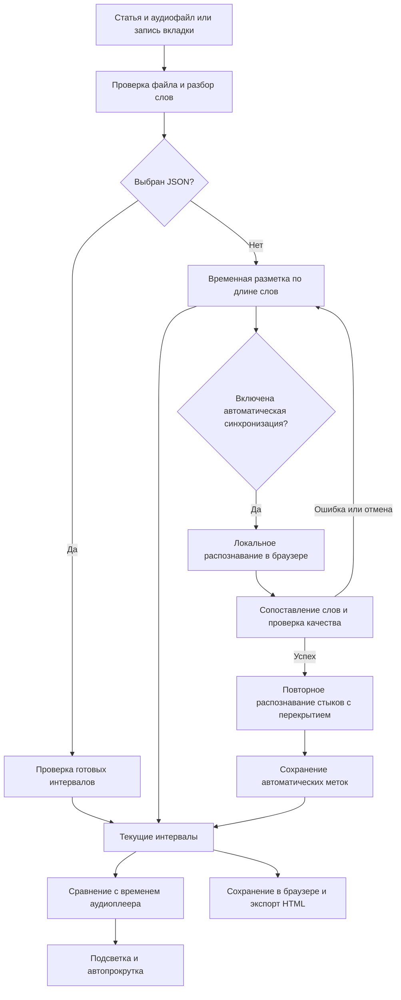

# Синхронизация текста и аудио

speechread сопоставляет текст с импортированным аудиофайлом или записью вкладки. Автоматическая обработка запускается при добавлении материала, если включён соответствующий переключатель и не выбран файл JSON.

## Как пользоваться

1. В форме **«Добавить материал»** вставьте текст, включая озвученные заголовки, и выберите аудиофайл либо запишите вкладку.
2. Оставьте включённой **«Автоматически синхронизировать слова с записью»** и нажмите **«Начать чтение»**.
3. Дождитесь уведомления о завершении. Во время обработки доступны воспроизведение и кнопка отмены; до успешного завершения используется прежняя, приблизительная разметка.
4. Проверьте несколько мест на слух, особенно начало, паузы, числа и собственные имена. Для повторной обработки откройте кнопку состояния синхронизации над текстом и выберите **«Синхронизировать автоматически»**.
5. После проверки можно сохранить HTML-страницу и аудио. В HTML попадут текущие метки; если скачать страницу до завершения, в неё попадёт предыдущая разметка.

При первом запуске браузер скачивает модель Whisper base и её компоненты — примерно 200 МБ. Требуются интернет и свободное место. Файлы модели могут кешироваться браузером; очистка данных сайта или политика браузера могут их удалить. Распознавание выполняется на устройстве, текст и запись не отправляются на сервер. Скорость зависит от компьютера, браузера и длительности записи; обработка длинных статей может быть продолжительной. Используйте актуальный Chrome или Edge на компьютере и не закрывайте вкладку до завершения.

## Как получается время слов

Модель распознаёт речь с временными метками слов. Приложение сопоставляет распознанную последовательность с исходной статьёй; регистр, знаки препинания и различие `е` / `ё` игнорируются. Слова вроде «вовремя» и «во время» могут сопоставляться как единый фрагмент. Если слово отсутствует в распознавании, его время оценивается между соседними совпадениями. Длинные паузы сохраняются, когда находятся между распознанными словами.

Речь около границ 30-секундных фрагментов повторно распознаётся с окружающим звуком, чтобы уменьшить сдвиги на стыках. Это увеличивает время обработки длинных записей. Если уточнить стыки не получилось, сохраняется исходный результат и показывается предупреждение.

Это **распознавание с последующим сопоставлением**, а не проверенное вручную forced alignment. Границы слов, числа, имена, шум, музыка, нерусская речь и несовпадение записи с текстом могут привести к ошибкам. Процент в уведомлении показывает совпадение текста с распознанными словами, но не доказывает точность каждой временной метки. Если совпало менее 80% слов статьи или распознанной речи, либо интервалы некорректны, автоматические метки не применяются. Предыдущий результат сохраняется также при ошибке или отмене.

Для воспроизведения используется `HTMLAudioElement.currentTime`; активный интервал ищется двоичным поиском. Во время воспроизведения проверка обновляется в кадрах браузера, а при перемотке — по событиям плеера. Между интервалами слово не подсвечивается. Нажатие на слово переводит запись к его началу. Переключатель **«Следить за текстом»** управляет автопрокруткой и не меняет метки.

Если автоматическая синхронизация отключена или ещё не завершена, время распределяется по длине слов и пунктуации без анализа пауз. Такая оценка также остаётся при ошибке и может заметно расходиться с голосом.

## Загрузка проверенных меток JSON

Нажмите кнопку состояния разметки над текстом и выберите **«Загрузить метки JSON»**, либо прикрепите JSON при импорте материала. Ручной редактор меток пока не предусмотрен.

```json
[
  {"word": "Привет", "start": 2.5, "end": 2.9},
  {"word": "мир.", "start": 3.0, "end": 3.6}
]
```

Для примера текст должен состоять из двух слов `Привет мир.`. Время — секунды от начала конкретного файла. Нужна метка для каждого слова, включая заголовки. Порядок и количество слов проверяются; интервалы должны иметь положительную длину, не перекрываться и помещаться в запись. Саму речь при загрузке JSON приложение не проверяет. При замене записи или текста могут понадобиться новые метки.

## Путь данных



Код: [сопоставление слов](../src/lib/alignment.ts), [уточнение стыков](../src/lib/boundary-sync.ts), [запуск модели](../src/lib/auto-sync.ts), [проверка и поиск интервалов](../src/lib/sync.ts), [плеер](../src/components/Reader.tsx), [HTML-экспорт](../src/lib/publication.ts).
